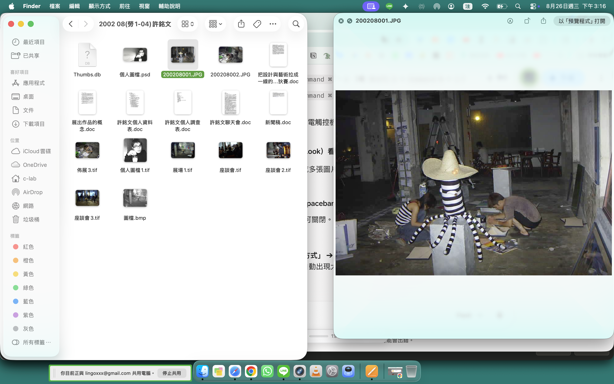
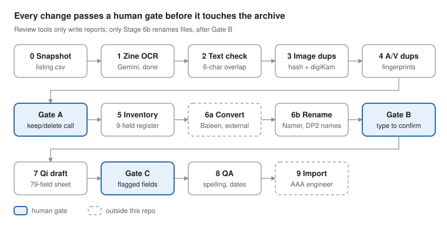
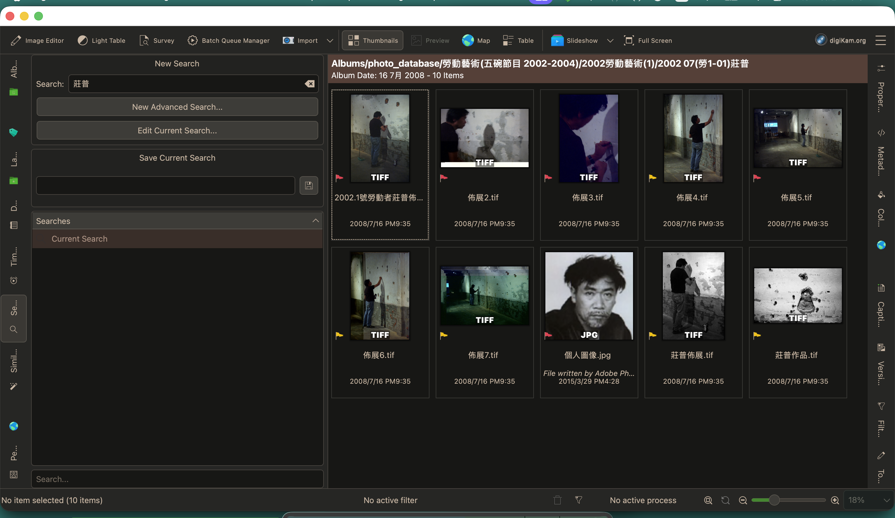

# Dogpig Art Cafe Archive Automation

**AI-Assisted Born-digital Archive Processing, Asia Art Archive (Taipei)**

> 中文說明請見下方〈中文版〉。

An AI-assisted, human-reviewed workflow for processing the born-digital archive of Dogpig Art Cafe (豆皮文藝咖啡館), an independent art space in Kaohsiung, Taiwan, active from 1999 to 2014. The work was done in September–October 2026 at Asia Art Archive's Taipei office, as the office's first large-scale born-digital processing project.

<p align="center">
  <br>
  <sub>Source material: an event flyer from the café's zine, with mixed vertical and horizontal text</sub>
</p>

<p align="center">
  <br>
  <sub>The archive as received: scans, legacy Word files, TIFF images and video side by side</sub>
</p>

## At a glance

Figures from a full listing of the archive's network drive on 23 November 2026 and from the tools' own run logs. System files are `.DS_Store`, `._*`, `Thumbs.db` and similar.

| | |
|---|---|
| Source folder (unprocessed) | 22,155 files (23,492 with system files), 1,044 folders, 395.7 GB |
| Processed area | 10,499 files (11,944 with system files) in 687 folders: 10 series and one unsorted folder, 69.4 GB |
| Zine OCR database | 48 issues, 96 scanned sheets, about 520,000 characters |
| Batch renaming, one series | 1,448 of 1,448 files renamed with zero errors; 9 ambiguous files routed to manual review |

## My role

I designed the workflow, wrote the specifications and review gates, and directed AI coding assistants to write and revise the scripts. I tested each tool on dry runs and real samples before it touched the archive. I do not write code myself; the design decisions, rules and acceptance checks are mine.

Format conversion uses **Baleen**, a separate tool built by an engineer collaborating with AAA Taipei ([czesito/walking-whale-baleen](https://github.com/czesito/walking-whale-baleen)). It is not part of this repository.

## Workflow



| Stage | What it does | Changes source files? |
|---|---|---|
| 0 Snapshot | List every file, size and extension under a series folder | No |
| 1 Zine OCR | Turn the 48-issue zine into searchable text with Gemini (one-off, complete) | No |
| 2 Text coverage | Check whether each document already appears in the zine, by runs of 6 matching Chinese characters | No |
| 3 Image duplicates | Group duplicate and near-duplicate photos (perceptual hash, filename families, digiKam review) and suggest which to keep | No |
| 4 A/V derivatives | Find exact duplicates, excerpts and merged recordings by audio fingerprint | No |
| Gate A | A person reviews the three reports and decides what to keep; any deletion is done by hand | Human |
| 5 Inventory | Register each folder in the archive inventory spreadsheet | No |
| 6a Convert | Convert legacy formats to JPEG, TIFF, PDF/A, MP4 or M4A and verify each with SHA-256 (Baleen, external) | No, writes to a separate folder |
| 6b Rename | Apply AAA's DP2 naming convention | Yes, in place |
| Gate B | Preview every rename; type a confirmation phrase; the tool rescans and stops if anything changed | Human |
| 7 Metadata draft | Draft the CMS import sheet from paths, filenames and event records; flag fields that need judgment | No |
| Gate C | A person reviews flagged fields (titles, descriptions, content types, names) | Human |
| 8 QA | Field-level checks: spelling, controlled terms, date order, durations vs. descriptions | No |
| 9 Import | Engineer imports the reviewed sheet into the CMS | Outside this repo |

Details: [docs/workflow.md](docs/workflow.md).

## Design principles

- **No tool deletes or moves an original.** Review tools write reports; deletion is always a human action.
- **Preview first.** Every change is shown in full before it runs, and runs only after explicit confirmation.
- **Never guess.** Anything a rule cannot decide is marked for review rather than resolved by the tool.
- **Every run leaves a record** that can be audited or rolled back (rename logs, name maps, checksums).

More: [docs/safety-and-qa.md](docs/safety-and-qa.md) · [docs/naming-convention.md](docs/naming-convention.md)

## Repository layout

```text
stages/
  s1_ocr/gemini_ocr.py                 Stage 1
  s2_text_coverage/coverage_compare.py Stage 2
  s3_image_review/digikam_smart_review.py Stage 3
  s4_av_review/video_edit_detect.py    Stage 4
  s5_inventory/build_inventory.py      Stage 5
  s6_rename/namer_tool/                Stage 6b (Namer v1.0)
legacy/                                retired tools, kept to show how the workflow evolved
docs/                                  workflow, naming convention, safety and QA
assets/                                screenshots and the workflow diagram
```

Stage 0, Stage 7, Stage 8 and a command-line runner that chains the stages are in progress.

## Quick start

```bash
pip install -r requirements.txt
# Stage 2: does a folder of documents already appear in the zine database?
python stages/s2_text_coverage/coverage_compare.py /path/to/folder --database merged.docx --output coverage.xlsx
# Stage 3: duplicate photos
python stages/s3_image_review/digikam_smart_review.py /path/to/folder --output duplicates.xlsx --family
# Stage 4 needs FFmpeg and Chromaprint
python stages/s4_av_review/video_edit_detect.py /path/to/folder --cache .video_fp_cache.json
```

## What I learned

The workflow changed direction several times: from digiKam's built-in search, to local OCR with PaddleOCR, to Google Docs OCR, to the Gemini vision model; from whole-file video matching to excerpt detection; from marking duplicate passages by hand to a repeatable coverage score. Each time I tested the cheapest manual version first and automated only after the results held up. That is the same habit archival work asks for: understand the material and its limits before deciding how to process it.

<p align="center">
  <br>
  <sub>An early dead end: digiKam's search matched filenames, not the text inside the images, which led to the OCR route</sub>
</p>

## Status and limitations

- The CMS metadata draft (Stage 7) has run as a dry run; it is not yet imported.
- Audio fingerprinting is weak on silent clips or clips with only background music.
- Converting legacy `.doc` files in Stage 2 relies on macOS `textutil`.

## License and credits

Code: MIT. The archive's content, including the zine and the screenshots in `assets/`, belongs to its rights holders and is not covered by the license. Baleen is a separate Apache-2.0 project by another developer. Courtesy of Leo Liu and Asia Art Archive.

---

# 中文版

## 豆皮文藝咖啡館檔案自動化處理

以 AI 輔助、人工把關的方式，處理高雄豆皮文藝咖啡館（1999–2014）的原生數位檔案。工作在 2026 年 9 至 10 月於亞洲藝術文獻庫（AAA）台北辦公室進行，是台北辦公室第一個大規模的原生數位檔案處理案。

## 數字一覽

依 2026 年 11 月 23 日 NAS 全樹清單與各工具的執行紀錄。系統檔指 `.DS_Store`、`._*`、`Thumbs.db` 等。

| | |
|---|---|
| 原始來源（未整理） | 22,155 個檔案（含系統檔 23,492）、1,044 個資料夾、395.7 GB |
| 整理區 | 10,499 個檔案（含系統檔 11,944）、687 個資料夾、10 個系列加 1 個待整理資料夾、69.4 GB |
| 豆皮丸 OCR 資料庫 | 48 期、96 張掃描、約 52 萬字 |
| 單一系列批次改名 | 1,448 個檔案全數改名、錯誤 0；9 個無法判斷的檔案轉人工複核 |

## 我的角色

我設計流程、寫規格與人工關卡，並指示 AI 程式助理撰寫與修改腳本。每個工具都先用 dry-run 與實際樣本測試，才用在檔案上。程式碼不是我親手寫的，設計決策、判斷規則與驗收標準是我的。

格式轉換使用 **Baleen**，由與 AAA 台北辦公室合作的工程師開發（[czesito/walking-whale-baleen](https://github.com/czesito/walking-whale-baleen)），不在本 repo 內。

## 流程

共 10 個 stage、3 道人工關卡（見上方英文版的流程圖與表格）。

1. **Stage 0 盤點**：列出系列資料夾內所有檔案、大小、副檔名。
2. **Stage 1 豆皮丸 OCR**：用 Gemini 把 48 期刊物轉成可搜尋的文字（一次性，已完成）。
3. **Stage 2 文字覆蓋比對**：以連續 6 個中文字為單位，判斷每份文件是否已收錄在豆皮丸裡。
4. **Stage 3 圖片查重**：以感知雜湊、檔名家族與 digiKam 人眼複核分組，給留刪建議。
5. **Stage 4 影音衍生關係**：以聲音指紋找出完全重複、剪輯片段與合併檔。
6. **關卡 A**：人工審閱三份報告，決定留刪；刪除一律人工執行。
7. **Stage 5 總清冊**：把資料夾登記進檔案清冊。
8. **Stage 6a 轉檔**：轉成 JPEG、TIFF、PDF/A、MP4、M4A，逐檔以 SHA-256 驗證（Baleen，外部工具）。
9. **Stage 6b 命名**：套用 AAA 的 DP2 命名規則。
10. **關卡 B**：完整預覽後輸入確認字句；執行前重新掃描，有任何變動就中止。
11. **Stage 7 metadata 草稿**：從路徑、檔名、活動登記表推出 CMS 匯入表，需要判斷的欄位插旗。
12. **關卡 C**：人工審閱插旗欄位。
13. **Stage 8 QA**：逐欄檢查拼字、受控詞、日期順序、時長與描述是否一致。
14. **Stage 9 匯入**：由工程師匯入 CMS（不在本 repo 範圍）。

## 設計原則

- 任何工具都不刪除、不搬動原始檔，刪除一律由人執行。
- 先預覽，明確確認後才執行。
- 規則判斷不了的，一律標記待複核，不讓工具猜。
- 每次執行都留下可稽核、可還原的紀錄（改名日誌、新舊檔名對照、checksum）。

## 開發歷程

流程轉向過好幾次：從 digiKam 內建搜尋、本地端 PaddleOCR、Google 文件 OCR，到 Gemini 多模態模型；影片從整檔比對到片段偵測；重複段落從人工標註到可重跑的覆蓋率分數。每次都先用成本最低的手動方式驗證，確認品質後才自動化。這也是檔案工作的習慣：先理解材料的特性與限制，再決定怎麼處理。

舊版工具保留在 `legacy/`：`01_batch_ocr_merge.py`（Google 文件 OCR）與 `03_mark_duplicates_new.py`（以刪除線標註重複段落），已由 Stage 1 與 Stage 2 取代。

## 授權

程式碼採 MIT 授權。豆皮文藝咖啡館刊物與 `assets/` 截圖的版權屬原權利人，不在授權範圍內。Baleen 為另一位開發者的 Apache-2.0 專案。資料提供：劉秋兒及亞洲藝術文獻庫。
