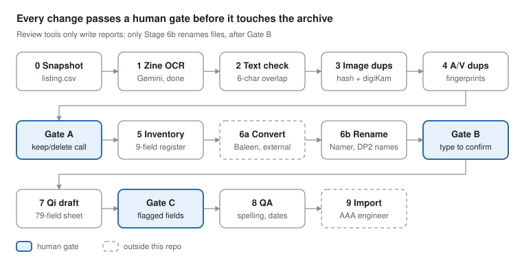

# Workflow

Ten stages and three human gates. Review stages only write reports; Stage 6b is the only stage that changes source files, and only after Gate B.



Conventions shared by every tool:

- Read-only by default. Output spreadsheets merge into an existing file and keep any "reviewed" ticks, so a stage can be re-run safely.
- System files (`.DS_Store`, `._*`, `Thumbs.db`, `desktop.ini`) are skipped.
- Anything a rule cannot decide is marked for review. Tools never guess.

## Stage 0 · Snapshot (in progress)

List every file under a series folder: relative path, size, modified time, system-file flag. Produces `listing.csv` and a summary (file count, folder count, bytes, extension counts). Optional SHA-256 for later source-to-processed mapping.

## Stage 1 · Zine OCR (`stages/s1_ocr/gemini_ocr.py`, complete)

The café's zine (48 issues, 96 scanned sheets) was turned into one searchable document of about 520,000 characters. Local OCR (PaddleOCR) and Google Docs OCR both failed on halftone print with mixed vertical and horizontal Chinese text, so the final run used the Gemini vision model with a prompt that fixes reading order.

- API key from the `GEMINI_API_KEY` environment variable; images downscaled to 1,200 px on the long edge; exponential back-off on rate limits.
- Each scan gets a heading `檔案：{filename}`, which Stage 2 uses to trace a match back to its issue.

## Stage 2 · Text coverage (`stages/s2_text_coverage/coverage_compare.py`)

Decides whether each document in a folder is already published in the zine.

```bash
python coverage_compare.py <folder> --database merged.docx --output coverage.xlsx
```

| Class | Rule (defaults) |
|---|---|
| Largely published | match rate ≥ 50% |
| Partly published | match rate ≥ 12%, or a run of ≥ 25 matching characters |
| Scattered matches | 5% to 12% (usually common names) |
| Not published | below 5% |
| Too short | 6 Chinese characters or fewer |

A match is a run of at least 6 Chinese characters (`--min-match 6`) after stripping punctuation, whitespace, Latin letters and digits, so OCR punctuation differences do not count; an index map keeps positions tied to the original text. `.doc` and `.rtf` files are converted with macOS `textutil` first; on other systems they are reported as unreadable.

## Stage 3 · Image duplicates (`stages/s3_image_review/digikam_smart_review.py`)

```bash
python digikam_smart_review.py <folder> --output duplicates.xlsx [--pairs-csv pairs.csv] [--groups-csv groups.csv]
```

- Every run groups by filename family and by perceptual hash together (`--hash-size 16`, `--exact-max-dist 3`, `--similar-max-dist 14`) and merges the results without double-counting. Until 23 September 2026 these were separate modes, and forgetting the second run left groups out of the sheet; `--family` is still accepted but no longer needed.
- Hash comparison stays within each folder by default, since one event's photos rarely appear in another event's folder; `--cross-folder` compares across folders and is much slower. `--skip-hash` runs filename families only.
- digiKam's "Find Duplicates" is run by hand at three similarity bands (100%, 80–90%, 50–80%). Pairs a person confirms there are fed back with `--pairs-csv`; a union-find merge joins pairs that share a file into one group, because digiKam's similarity is not transitive. Groups exported from digiKam's database can be added with `--groups-csv`; both inputs are merged with the automatic groups, not substituted for them.
- Keep rule, in order: an original over an edited copy; then higher resolution; then, within 3% (`--near-tie-pct 3`), the larger file; otherwise "needs review". Burst shots (`--burst-seconds 10`) are never suggested for deletion.
- Re-running merges with the previous sheet by file path, so rows already marked confirmed, deleted or on hold keep their status.
- `test_digikam_smart_review.py` (42 checks, synthetic images only) covers the keep rules, the burst and grayscale exceptions, group merging and the guarantee that no file is written beside a source photo. Run it after every change.

## Stage 4 · A/V derivatives (`stages/s4_av_review/video_edit_detect.py`)

```bash
python video_edit_detect.py <folder> --cache .video_fp_cache.json
```

Slides Chromaprint audio fingerprints against each other to classify pairs as exact duplicates (`--dup-threshold 4.0`), excerpts of a longer recording (`--sub-threshold 8.0`, `--min-cover 0.85`), or a long file merged from shorter ones. Whole-file matching of edited video is done separately in Video Duplicate Finder with the DINOv2 model. Weak on silent clips or clips with only background music.

Example from the archive: in one performance folder of seven files, the tool traced a 41-minute WAV master, four WMV exports of its first 28 minutes at different bit rates, and a 9:39 excerpt cut from one of them. A second WAV matched only moderately and was left for a person to listen to.

## Gate A · Keep or delete

A person reviews the three spreadsheets, opens every "needs review" item, and ticks "reviewed". Deletion, if any, is done by hand outside the tools.

## Stage 5 · Inventory (`stages/s5_inventory/build_inventory.py`)

```bash
python build_inventory.py <folder> --output inventory.xlsx [--dry-run]
```

Registers one row per file in the archive's existing nine-field inventory: space name, original location, folder name, file name, ID (manual), content (extension), quantity (always 1), condition (manual), notes. Re-running merges and never overwrites rows or manual fields. Inventory is taken before renaming so it records original names; Stage 6b's `name_map.csv` links them to the new names.

## Stage 6a · Format conversion (Baleen, external)

Baleen converts non-archival formats to JPEG, TIFF, PDF/A, MP4 or M4A into a mirrored output folder, verifies every output (full decode, veraPDF for PDF/A) and records SHA-256 in a CSV report. This repository only checks that the output folder and its `_baleen/` report exist.

## Stage 6b · Rename (`stages/s6_rename/namer_tool/`)

See [naming-convention.md](naming-convention.md).

```bash
python -m namer plan <root> --rules rules.json --out <dir>
python -m namer apply <root> --confirm "確認 rename"
python -m namer verify <root> --log rename_log.csv
python -m namer rollback <root> --log rename_log.csv --confirm "..."
```

## Gate B · Confirm rename

The person reviews the full preview and types the confirmation phrase. Before renaming, the tool rescans and compares every row with the approved preview; any difference aborts the run with no file changed.

## Stage 7 · CMS metadata draft (in progress)

Drafts the CMS import sheet from folder paths, filenames and the event register. Field rules were derived from 625 records already cataloged by hand in another series: constant fields, media-folder IDs by file type, PDF page counts and video durations written into descriptions, dates from the event register (estimated = 0) with a fallback to the filename's year and month (estimated = 1). Fields that need someone to look at the content (title, description, content type, names) are drafted and flagged. Institution-specific IDs and the folder map are read from a profile file that is not published.

## Gate C · Review flagged fields

A person reviews every flagged field before the sheet goes to QA.

## Stage 8 · QA (one pass run; reusable script in progress)

Field-level checks with no changes to the sheet: spelling against a list of known typos, controlled terms against the dropdown sheet, start date before end date and blank end date for single-day events, category month vs. filename month, duration field vs. description, name–role pairs. Each finding has a cell reference, the original value, a reason and a suggested fix, in three classes: definite error, internal inconsistency, needs confirmation. Results of the first full pass are in [safety-and-qa.md](safety-and-qa.md).

## Stage 9 · Import

An engineer imports the reviewed sheet into the CMS. Outside this repository.
